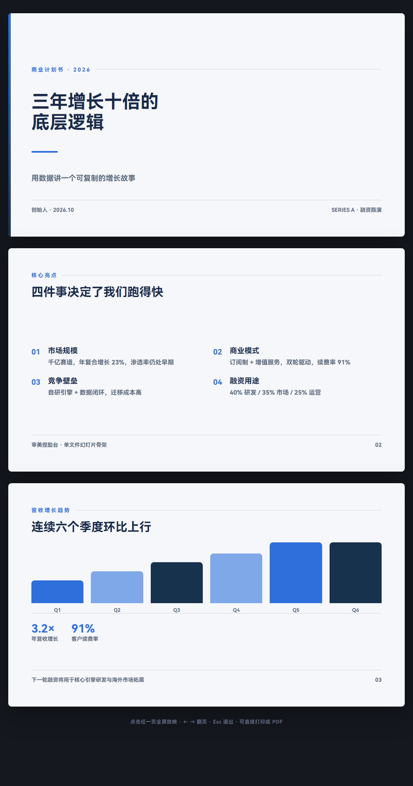

# 审美捏脸台 · Aesthetic Forge

> 像游戏开局捏脸一样选 PPT 风格：选一套设计方案，逐维微调，实时看效果，最后拿到能直接喂给 AI 的提示词。

[](LICENSE)
[](ppt-aesthetic-forge.html)
[](#技术实现)
[](CONTRIBUTING.md)

**[在线试用](https://lalalaHulala.github.io/ppt-aesthetic-forge/) · [国内镜像](https://cdn.jsdelivr.net/gh/lalalaHulala/ppt-aesthetic-forge@main/ppt-aesthetic-forge.html) · [下载单文件](https://raw.githubusercontent.com/lalalaHulala/ppt-aesthetic-forge/main/ppt-aesthetic-forge.html) · [反馈问题](../../issues)**


---

## 怎么用：挑最省事的那条

| 你的情况 | 做法 | 花多久 |
| --- | --- | --- |
| 想先看看 | [打开在线版](https://lalalaHulala.github.io/ppt-aesthetic-forge/) 点几下 | 10 秒 |
| 正在跟 AI 聊着做 PPT | 把 [`ai/prompt.txt`](ai/prompt.txt) 那段话粘进去 | 一句话 |
| 想要现成页面，不想从零排版 | 让 AI 用 [`ai/starter.html`](ai/starter.html) 填内容 | 一次对话 |
| 写代码 / 做 agent | [`npx paf` 或 MCP server](#接到-ai--agent-里用) | 一条命令 |
| GitHub 打不开 | 全站有 [jsDelivr 镜像](https://cdn.jsdelivr.net/gh/lalalaHulala/ppt-aesthetic-forge@main/) | — |

AI 会用工具，就给它一条链接；不会用工具，就给它一段话。两条路都通。

---

## 给 AI 的入口（重要）

主文件 118KB，**是给人点着用的界面，别让模型去读它**。数据和规格在更小的文件里，体积小 95%，内容等价：

| 文件 | 大小 | 给谁 | 里面是什么 |
| --- | --- | --- | --- |
| [`llms.txt`](llms.txt) | 3.7KB | 自动探测 | 总入口，[llms.txt 标准](https://llmstxt.org) |
| [`ai/spec.md`](ai/spec.md) | 13KB | 模型 | 10 套方案的完整令牌，一次读完就能复现 |
| [`ai/starter.html`](ai/starter.html) | 10KB | 模型 | 可直接运行的 960×540 骨架，改令牌 + 文案即成品 |
| [`ai/presets.json`](ai/presets.json) | 42KB | 脚本 | 同上的 JSON 版，带 CSS 变量，给 CLI / MCP / 构建流程 |



*`ai/starter.html` 的三页：封面 / 要点 / 图表，纯 CSS，零依赖，点击任页全屏放映，也能直接打印成 PDF。*

还有两条**不消耗 token** 的路子：

- **直达链接**：`?g=editorial` 打开杂志编辑那套；拖过滑杆就自动带上 `&a=80&r=10`，`&page=chart` 指定页。AI 只要给用户一条 URL，不用它自己渲染。
- **嵌入模式**：`&embed=1` 只留画面、零界面，可直接 iframe 到文档 / Notion / 飞书。

```html
<iframe src="https://lalalaHulala.github.io/ppt-aesthetic-forge/?g=editorial&embed=1"
        width="960" height="540" style="border:0" loading="lazy"></iframe>
```

这些文件全部由 `ppt-aesthetic-forge.html` 自动生成（`node tools/gen-ai.mjs`），CI 会校验一致性——改了 HTML 忘了同步，构建直接失败。

**要长期稳定就锁版本**。上面的链接走 `@main`，会跟着仓库变；如果下游拿它做批量生成，把 `@main` 换成 tag，输出才不会某天突然变样：

```text
https://cdn.jsdelivr.net/gh/lalalaHulala/ppt-aesthetic-forge@v1.2.0/ai/spec.md
```

GitHub Pages 没有版本路径，锁版本走 jsDelivr。托管和 CDN 都在免费额度内，没有服务器、没有数据库、不消耗任何 API 额度——**调用成本只取决于模型读了多少字**，这也是把 118KB 砍到 13KB 的原因。

---

## 这玩意儿解决什么问题

让 AI 帮你做 PPT，最常卡住的一步是**描述审美**。

你说"要高级一点"，模型给你加渐变和发光；你说"简约专业"，它把字调小、加一堆图标。来来回回改七八版，你也说不清到底哪儿不对——因为你脑子里有画面，但手上没有词。

这个工具把"说审美"变成"选审美"：**10 套经过去重的设计方案**，每套都有真实来源和明确适用场景；选定后还能单独调配色、字体、图形、密度、质感，幻灯片**实时变化**。等你觉得对了，直接复制它生成的提示词 / 设计令牌，交给任意 PPT 生成 skill 或 AI 工具。

一句话：**把审美从形容词变成参数。**

---

## 功能

**捏脸（选）**
- 10 套设计方案，分 7 类（经典简约 / 商务数据 / 出版叙事 / 科技未来 / 人文东方 / 严肃正式 / 创意表现）
- 每套都是**独立视觉模板**：封面构图、内页结构、签名细节各不相同，不是换色
- 5 个微调维度：配色方案（11 种）、字体搭配（5 种）、图形语言（6 种）、版式密度（3 种）、背景质感（5 种，收在「更多质感」里）
- 每个选项都带小预览图，**鼠标悬停即整套预演**，不用点下去才知道效果

**预览（看）**
- 960×540 真实 16:9 画布，封面 / 内页 / 图表页三种版式实时渲染
- 底部页面序列缩略图，缩放（适应 / 50% / 75% / 100%）
- 前后对比模式、专注模式（隐藏侧栏全屏看）

**输出（拿）**
- **分享链接**：一条 URL 编码整套配置，点开即是同一套审美，参数可手改
- **提示词**：带设计令牌（色值 / 字级 / 圆角 / 间距 / 对比度），直接复制给 AI
- **CSS 变量**：`:root` 就绪，粘到项目里就能用
- **HTML 幻灯片**：导出成可直接放映的单文件
- **我的预设**：把当前配置存到浏览器本地，随时切回

**交互**
- 撤销 / 重做（80 步）、随机捏脸、全键盘操作、深色界面

---

## 快速开始

### 方式一：下载双击（推荐）

下载 [`ppt-aesthetic-forge.html`](ppt-aesthetic-forge.html)，双击用浏览器打开。

没有安装、没有构建、不联网、不上传任何数据。想换电脑就发这个文件。

### 方式二：在线使用

打开 <https://lalalaHulala.github.io/ppt-aesthetic-forge/>

### 方式三：克隆下来

```bash
git clone https://github.com/lalalaHulala/ppt-aesthetic-forge.git
cd ppt-aesthetic-forge
# 直接打开，或起个本地服务
python -m http.server 8000
```

---

## 10 套设计方案

资料来自 ppt-master 的三轴风格体系、Gixo 的 34 套主题、MBB（McKinsey / BCG）咨询设计规范、tyaward 的简报风格分类。**按相似度去重，同一视觉家族只留一个代表**（北欧并入极简、产品发布并入主题演讲、赛博朋克/蒸汽波并入暗色科技、信息密集并入咨询报告、孟菲斯并入波普、插画并入手绘）。

| 分类 | 方案 | 视觉特征 | 适合场景 |
| --- | --- | --- | --- |
| 经典简约 | **极简 / 北欧** | 高留白 · 单焦点 · 2-3 色 | 投资人路演、高管简报、产品发布 |
| 经典简约 | **主题演讲** | Hero 大字 · 高级留白 | 产品发布、TED 式演讲、品牌宣发 |
| 商务数据 | **咨询报告** | 结论前置 · 单页单结论 · 克制配色 | 战略汇报、董事会、尽调 |
| 出版叙事 | **杂志编辑** | 大图叙事 · 非对称版式 · 衬线反差 | 品牌故事、人物专访、作品集 |
| 科技未来 | **暗色科技** | 深色底 · 霓虹点缀 · 未来感 | 科技产品发布、AI / 数据平台、开发者大会 |
| 人文东方 | **新中式** | 水墨留白 · 朱砂点缀 · 传统纹样克制 | 文化传播、文旅、新消费品牌、节庆 |
| 严肃正式 | **学术答辩** | 严格层级 · 编号 · 引用规范 | 论文答辩、学术会议、基金申报 |
| 严肃正式 | **政府汇报** | 红蓝庄重 · 对称端正 · 标题加粗 | 政府汇报、党建宣传、年度总结 |
| 创意表现 | **文艺手绘** | 手绘线条 · 暖色纸感 · 涂鸦元素 | 课堂教学、工作坊、创意提案 |
| 创意表现 | **活泼波普** | 高饱和大色块 · 粗描边 · 硬阴影 | 校园活动、社群营销、Z 世代品牌 |

选中任意一套，右栏会给出这套方案的**好处 / 适用场景 / 来源**，方便你判断该不该用它。

| 暗色科技 | 新中式 |
| --- | --- |
|  |  |

---

## 快捷键

| 按键 | 作用 |
| --- | --- |
| `1` – `6` | 切换捏脸维度 |
| `←` / `→` | 翻页（封面 / 内页 / 图表） |
| `R` | 随机捏脸 |
| `B` | 前后对比模式 |
| `F` | 专注预览 |
| `Ctrl+Z` / `Ctrl+Shift+Z` | 撤销 / 重做 |
| `?` | 帮助 |
| `Esc` | 关闭面板 / 退出模式 |

---

## 输出长什么样


**分享链接**只写「跟方案默认值不一样」的部分，所以大多数人拿到的就是一条十几个字符的 URL：

```
https://lalalahulala.github.io/ppt-aesthetic-forge/?g=editorial
```

顺手拖了几下微调滑杆，参数才自己长出来：

```
?g=editorial&a=80&r=10
   方案 id  强调强度 圆角
```

全部参数，省略即取该方案的默认值：

| 参数 | 含义 | 取值 |
|---|---|---|
| `g` | 设计方案 | `minimal` `keynote` `consulting` `editorial` `darktech` `guochao` `academic` `gov` `hand` `pop` |
| `c` | 配色 | `mono` `inkblue` `earth` `deepnavy` `inkwash` `redgold` `candy` `neon` |
| `t` | 字体 | `sans` `serif` `mono` `round` `kai` |
| `f` | 图形 | `line` `block` `glow` `photo` `hand` `datagrid` |
| `x` | 质感 | `clean` `grid` `glass` `neon` `ink` |
| `d` | 密度 | `airy` `standard` `dense` |
| `a` `r` `w` `s` | 强调强度 / 圆角 / 留白 / 字号比例 | 0–100 |
| `page` | 直接翻页 | `1` `2` `3` |
| `embed` | 只留画面 | `1` |

想改哪一项直接改 URL 就行，不必回到界面里点。

**提示词** 可以整段交给任何 PPT 生成工具：

```
【设计方案】极简 / 北欧（id: minimal）
【设计令牌 DESIGN TOKENS】
colors.bg=#F5F7FA · surface=#FFFFFF · text=#1B2A4A · primary=#17324D · accent=#2E6FDB
typography.head=HarmonyOS Sans SC · weight=800 · letterSpacing=0em
radius=10px · pad=64px · gap=20px · title=39.5px · body=18.7px
contrast.body=13.3:1（WCAG AA 达标线 4.5:1）
```

比"高级一点、简约一点"这种描述，模型能抓到的东西多得多。

---

## 接到 AI / Agent 里用

网页只是入口。真正的用法是让**生成 PPT 的那一方**直接读到这份规格——否则每次都靠人复制粘贴。

仓库里带了三种接入形态，全部零依赖（Node 18+，不需要 `npm install`）：

### 一、命令行（任何能执行命令的 agent 都能用）

```bash
node bin/paf.mjs list                            # 10 套方案 + 好处 + 场景
node bin/paf.mjs spec --design keynote           # 规格简报（markdown）
node bin/paf.mjs spec --design darktech --json    # 完整 JSON
node bin/paf.mjs spec --design consulting --prompt  # 只要提示词
node bin/paf.mjs spec --design editorial --url   # 只要分享链接
node bin/paf.mjs url '?g=guochao&a=80'           # 从链接还原规格
```

规格 JSON 长这样（节选）：

```json
{
  "url": "https://lalalahulala.github.io/ppt-aesthetic-forge/?g=darktech",
  "design": { "id": "darktech", "template": "darktech", "mood": "dark" },
  "tokens": {
    "colors": { "bg": "#0B1526", "text": "#E8EEF6", "accent": "#00D4FF", "chart": ["#00D4FF", "..."] },
    "fonts":  { "head": "JetBrains Mono", "headWeight": 700 },
    "metrics":{ "radiusPx": 10, "padPx": 46, "gapPx": 20, "titleSizePx": 39.5 }
  },
  "contrast": { "body": 15.65, "sub": 6.95, "accent": 10.32, "pass": true }
}
```

### 二、MCP server（Claude Desktop / Cursor / 任何支持 MCP 的 agent）

```json
{
  "mcpServers": {
    "ppt-aesthetic-forge": {
      "command": "node",
      "args": ["/绝对路径/bin/paf-mcp.mjs"]
    }
  }
}
```

暴露 5 个工具：`list_design_presets`、`get_design_spec`、`apply_share_link`、`get_style_prompt`，外加一个已弃用但保留的 `apply_design_dna`（兼容旧编码）。手写 JSON-RPC，没有第三方依赖。

### 三、Agent Skill（Claude Code / WorkBuddy / Codex）

复制 `skill/SKILL.md` 到你的 skills 目录，或直接在仓库里指向它。Skill 里写清了：什么时候该调用、怎么按场景挑方案、交付时该用哪个字段。

### 四、嵌进网页

它就是个静态文件，直接 iframe 即可：

```html
<iframe src="ppt-aesthetic-forge.html" style="width:100%;height:900px;border:0"></iframe>
```

### 接不进去的地方

Kimi PPT、iSlide、Gamma、AiPPT 这类**闭源 AI PPT 工具没有插件生态**，只接受自然语言提示词。对它们只能用 `--prompt` 输出整段文字人工粘贴——这也是 `promptText()` 里塞满具体令牌值的原因：让模型有东西可抓，而不是只看到"高级感"三个字。

---

## 技术实现

- **单文件、零依赖、零构建**：一个 HTML 里塞了样式、数据、逻辑。不需要 Node、不需要打包，拷贝就能用。
- **CSS 变量驱动**：整套视觉是 `--bg` `--text` `--accent` `--radius` `--pad` `--tsize` 等几十个变量，切换方案就是改一批变量 + 换一个 `tp-*` 模板类。
- **模板即类名**：`tp-minimal` / `tp-keynote` / `tp-darktech` … 每个方案一份 CSS 区块，负责封面构图、内页结构、签名装饰。
- **数据与视图分离**：所有方案、配色、字体、规则集中在文件顶部的 `OPTS` 常量里，改数据不用碰渲染逻辑。
- **无网络请求**：打开 DevTools 的 Network 面板验证——除了文件本身，一条请求都没有。

文件结构：

```
ppt-aesthetic-forge/
├── ppt-aesthetic-forge.html      # 网页本体：全部样式、数据、逻辑都在这一个文件
├── bin/
│   ├── paf.mjs                   # 命令行
│   └── paf-mcp.mjs               # MCP server（零依赖，手写 JSON-RPC）
├── tools/
│   ├── forge-core.mjs            # 从 HTML 里提取「大脑」，单一数据源
│   └── selftest.mjs              # 25 项自检，CI 里跑
├── skill/SKILL.md                # Agent Skill 说明
├── docs/screenshots/             # README 配图
├── .github/                      # issue / PR 模板、Pages 部署、CI
├── package.json
├── README.md
├── CONTRIBUTING.md
├── CODE_OF_CONDUCT.md
├── CHANGELOG.md
└── LICENSE
```

**关于「单一数据源」**：`tools/forge-core.mjs` 不会复制任何方案数据。它用一套最小 DOM 桩把 HTML 里的内联脚本跑起来，直接调用其中的 `OPTS`、`shareUrl()`、`promptText()`。所以改了 HTML，CLI 和 MCP 自动跟着变，不存在两边数据漂移的问题——`tools/selftest.mjs` 就是用来在 CI 里守住这条的。

---

## 致谢

设计方案的分类体系与视觉规范参考了这些公开资料：

- [ppt-master](https://github.com/hugohe3/ppt-master) —— 三轴风格体系（模板风格 / 布局 / 配色）
- **Gixo** 34 套 PPT 主题（每套附 Best For 场景说明）
- **MBB**（McKinsey / BCG）咨询幻灯片规范 —— 行动标题、单页单结论、克制配色
- **tyaward** 15 种简报风格、**Autoppt** 6 种风格分类

同时收录了三个开源 PPT 生成 skill 作为下游工具（工具内「输出」页可直接复制安装命令）：

- [dashi-ppt-skill](https://github.com/chuspeeism/dashi-ppt-skill)（AGPL-3.0）
- [slide-creator](https://github.com/kaisersong/slide-creator)
- [ppt-master](https://github.com/hugohe3/ppt-master)

本项目只借鉴上述资料的设计思想与分类方法，未复制其代码。

另外，设计令牌与对比度标准的思路来自 Google 的 DESIGN.md 规范与 WCAG 2.1。

---

## 路线图

- [ ] 自定义文案（目前用固定的商业路演样例）
- [ ] 导出 PPTX（现在导出的是 HTML 幻灯片）
- [ ] 更多方案模板（数据新闻、极简年报、教育课件）
- [ ] 繁体 / 英文界面
- [ ] 移动端适配（当前面向桌面）

有想法欢迎开 issue；想自己动手看 [CONTRIBUTING.md](CONTRIBUTING.md)。

---

## 贡献

欢迎提 issue 和 PR，尤其是**新的设计方案**。加一套方案的门槛很明确：必须和现有 10 套在视觉上明显不同、有可查的来源、场景说得清。详见 [CONTRIBUTING.md](CONTRIBUTING.md)。

参与本项目即表示同意遵守 [行为准则](CODE_OF_CONDUCT.md)。

---

## 许可

[MIT](LICENSE) © 2026 小咔

随便用、随便改、商用也行，保留版权声明即可。

---

## English

**Aesthetic Forge** is a single-file, zero-dependency HTML tool for picking a PPT design aesthetic the way you'd customize a game character.

Instead of describing "make it look premium" to an AI, you pick from 10 deduplicated design systems — each a genuinely distinct template, not a recolor — then fine-tune palette, typography, graphics, density and texture with live preview. When it looks right, copy the generated **prompt + design tokens** (colors, type scale, radius, spacing, WCAG contrast) into any PPT-generating AI skill.

- 10 curated designs, 7 categories, with documented sources and use cases
- 5 fine-tuning dimensions, hover-to-preview
- Export: shareable URL, prompt text, CSS variables, standalone HTML deck
- Undo/redo, compare mode, focus mode, full keyboard control
- No install, no build, no network calls — just open the HTML file

License: MIT.
