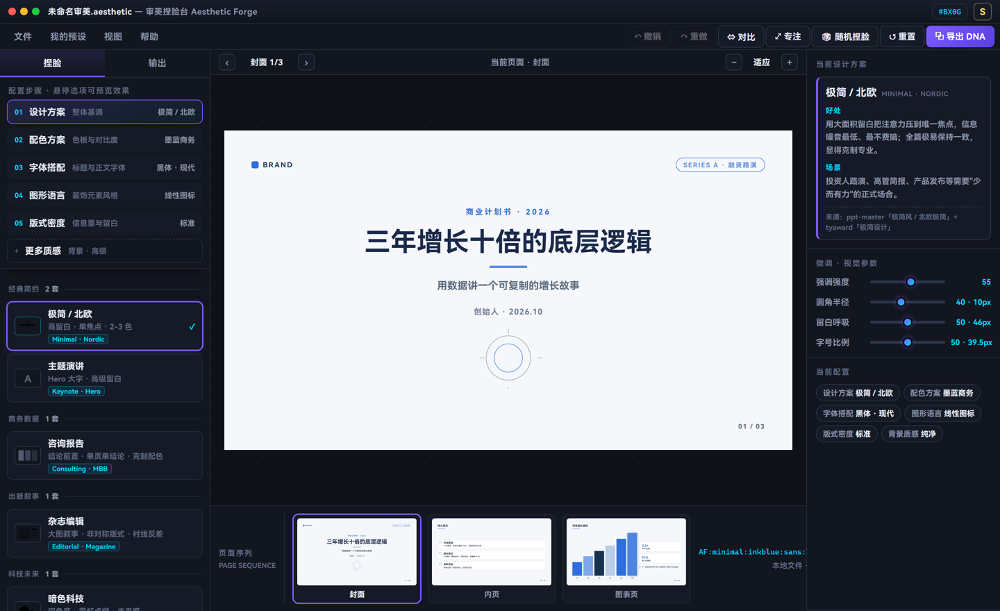
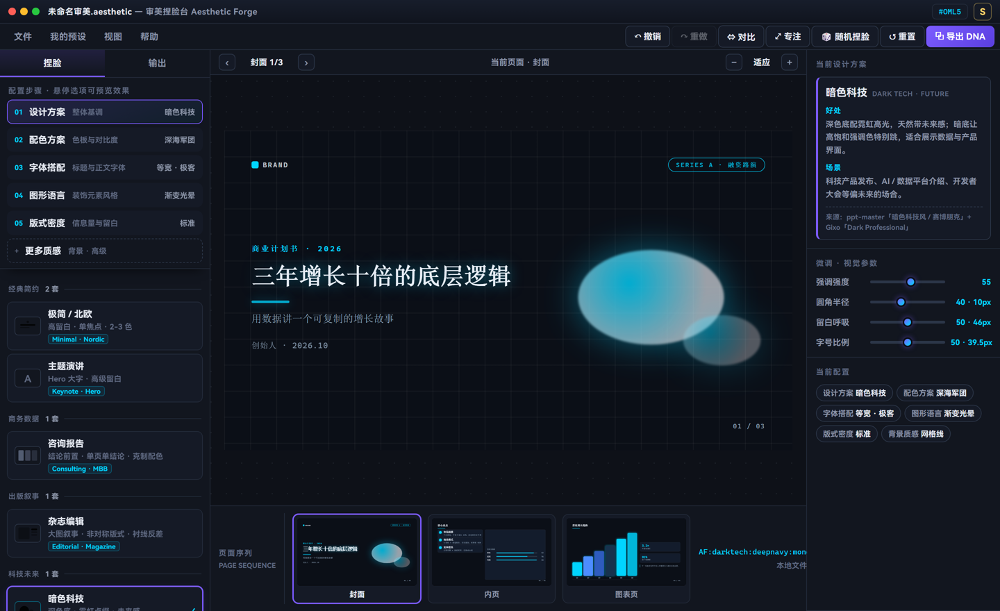
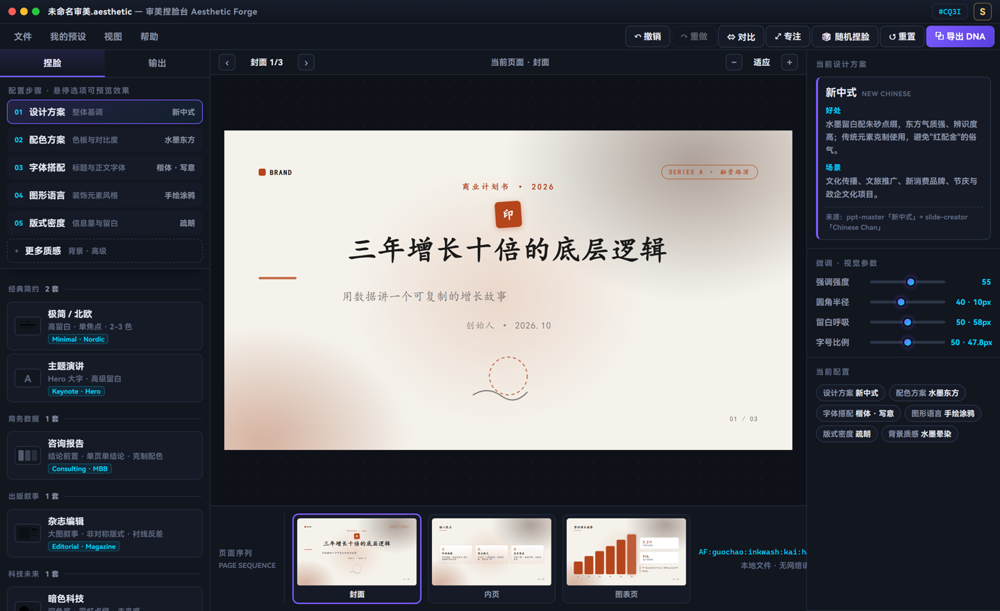
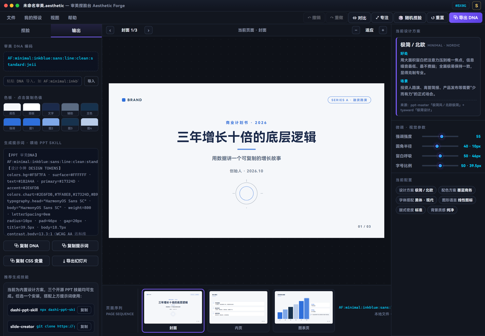

# 审美捏脸台 · Aesthetic Forge

> 像游戏开局捏脸一样选 PPT 风格：选一套设计方案，逐维微调，实时看效果，最后拿到能直接喂给 AI 的提示词。

[](LICENSE)
[](ppt-aesthetic-forge.html)
[](#技术实现)
[](CONTRIBUTING.md)

**[在线试用](https://lalalaHulala.github.io/ppt-aesthetic-forge/) · [下载单文件](https://raw.githubusercontent.com/lalalaHulala/ppt-aesthetic-forge/main/ppt-aesthetic-forge.html) · [反馈问题](../../issues)**



---

## 这玩意儿解决什么问题

让 AI 帮你做 PPT，最常卡住的一步是**描述审美**。

你说"要高级一点"，模型给你加渐变和发光；你说"简约专业"，它把字调小、加一堆图标。来来回回改七八版，你也说不清到底哪儿不对——因为你脑子里有画面，但手上没有词。

这个工具把"说审美"变成"选审美"：**10 套经过去重的设计方案**，每套都有真实来源和明确适用场景；选定后还能单独调配色、字体、图形、密度、质感，幻灯片**实时变化**。等你觉得对了，直接复制它生成的提示词 / 设计令牌，交给任意 PPT 生成 skill 或 AI 工具。

一句话：**把审美从形容词变成参数。**

---

## 功能

**捏脸（选）**
- 10 套设计方案，分 7 类（经典简约 / 商务数据 / 出版叙事 / 科技未来 / 人文东方 / 严肃正式 / 创意表现）
- 每套都是**独立视觉模板**：封面构图、内页结构、签名细节各不相同，不是换色
- 5 个微调维度：配色方案（11 种）、字体搭配（5 种）、图形语言（6 种）、版式密度（3 种）、背景质感（5 种，收在「更多质感」里）
- 每个选项都带小预览图，**鼠标悬停即整套预演**，不用点下去才知道效果

**预览（看）**
- 960×540 真实 16:9 画布，封面 / 内页 / 图表页三种版式实时渲染
- 底部页面序列缩略图，缩放（适应 / 50% / 75% / 100%）
- 前后对比模式、专注模式（隐藏侧栏全屏看）

**输出（拿）**
- **审美 DNA**：一行字符串编码整套配置，可分享、可导入
- **提示词**：带设计令牌（色值 / 字级 / 圆角 / 间距 / 对比度），直接复制给 AI
- **CSS 变量**：`:root` 就绪，粘到项目里就能用
- **HTML 幻灯片**：导出成可直接放映的单文件
- **我的预设**：把当前配置存到浏览器本地，随时切回

**交互**
- 撤销 / 重做（80 步）、随机捏脸、全键盘操作、深色界面

---

## 快速开始

### 方式一：下载双击（推荐）

下载 [`ppt-aesthetic-forge.html`](ppt-aesthetic-forge.html)，双击用浏览器打开。

没有安装、没有构建、不联网、不上传任何数据。想换电脑就发这个文件。

### 方式二：在线使用

打开 <https://lalalaHulala.github.io/ppt-aesthetic-forge/>

### 方式三：克隆下来

```bash
git clone https://github.com/lalalaHulala/ppt-aesthetic-forge.git
cd ppt-aesthetic-forge
# 直接打开，或起个本地服务
python -m http.server 8000
```

---

## 10 套设计方案

资料来自 ppt-master 的三轴风格体系、Gixo 的 34 套主题、MBB（McKinsey / BCG）咨询设计规范、tyaward 的简报风格分类。**按相似度去重，同一视觉家族只留一个代表**（北欧并入极简、产品发布并入主题演讲、赛博朋克/蒸汽波并入暗色科技、信息密集并入咨询报告、孟菲斯并入波普、插画并入手绘）。

| 分类 | 方案 | 视觉特征 | 适合场景 |
| --- | --- | --- | --- |
| 经典简约 | **极简 / 北欧** | 高留白 · 单焦点 · 2-3 色 | 投资人路演、高管简报、产品发布 |
| 经典简约 | **主题演讲** | Hero 大字 · 高级留白 | 产品发布、TED 式演讲、品牌宣发 |
| 商务数据 | **咨询报告** | 结论前置 · 单页单结论 · 克制配色 | 战略汇报、董事会、尽调 |
| 出版叙事 | **杂志编辑** | 大图叙事 · 非对称版式 · 衬线反差 | 品牌故事、人物专访、作品集 |
| 科技未来 | **暗色科技** | 深色底 · 霓虹点缀 · 未来感 | 科技产品发布、AI / 数据平台、开发者大会 |
| 人文东方 | **新中式** | 水墨留白 · 朱砂点缀 · 传统纹样克制 | 文化传播、文旅、新消费品牌、节庆 |
| 严肃正式 | **学术答辩** | 严格层级 · 编号 · 引用规范 | 论文答辩、学术会议、基金申报 |
| 严肃正式 | **政府汇报** | 红蓝庄重 · 对称端正 · 标题加粗 | 政府汇报、党建宣传、年度总结 |
| 创意表现 | **文艺手绘** | 手绘线条 · 暖色纸感 · 涂鸦元素 | 课堂教学、工作坊、创意提案 |
| 创意表现 | **活泼波普** | 高饱和大色块 · 粗描边 · 硬阴影 | 校园活动、社群营销、Z 世代品牌 |

选中任意一套，右栏会给出这套方案的**好处 / 适用场景 / 来源**，方便你判断该不该用它。

| 暗色科技 | 新中式 |
| --- | --- |
|  |  |

---

## 快捷键

| 按键 | 作用 |
| --- | --- |
| `1` – `6` | 切换捏脸维度 |
| `←` / `→` | 翻页（封面 / 内页 / 图表） |
| `R` | 随机捏脸 |
| `B` | 前后对比模式 |
| `F` | 专注预览 |
| `Ctrl+Z` / `Ctrl+Shift+Z` | 撤销 / 重做 |
| `?` | 帮助 |
| `Esc` | 关闭面板 / 退出模式 |

---

## 输出长什么样



**审美 DNA** 是一行可分享的编码，8 段：

```
AF:minimal:inkblue:sans:line:clean:standard:jell
   └ 方案  └ 配色   └ 字体 └ 图形 └ 质感  └ 密度   └ 四项滑杆值（36 进制压缩）
```

导入「审美 DNA」输入框即可复现整套配置。

**提示词** 可以整段交给任何 PPT 生成工具：

```
【PPT 审美DNA】AF:minimal:inkblue:sans:line:clean:standard:jell
【设计令牌 DESIGN TOKENS】
colors.bg=#F5F7FA · surface=#FFFFFF · text=#1B2A4A · primary=#17324D · accent=#2E6FDB
typography.head=HarmonyOS Sans SC · weight=800 · letterSpacing=0em
radius=10px · pad=64px · gap=20px · title=39.5px · body=18.7px
contrast.body=13.3:1（WCAG AA 达标线 4.5:1）
```

比"高级一点、简约一点"这种描述，模型能抓到的东西多得多。

---

## 技术实现

- **单文件、零依赖、零构建**：一个 HTML 里塞了样式、数据、逻辑。不需要 Node、不需要打包，拷贝就能用。
- **CSS 变量驱动**：整套视觉是 `--bg` `--text` `--accent` `--radius` `--pad` `--tsize` 等几十个变量，切换方案就是改一批变量 + 换一个 `tp-*` 模板类。
- **模板即类名**：`tp-minimal` / `tp-keynote` / `tp-darktech` … 每个方案一份 CSS 区块，负责封面构图、内页结构、签名装饰。
- **数据与视图分离**：所有方案、配色、字体、规则集中在文件顶部的 `OPTS` 常量里，改数据不用碰渲染逻辑。
- **无网络请求**：打开 DevTools 的 Network 面板验证——除了文件本身，一条请求都没有。

文件结构：

```
ppt-aesthetic-forge/
├── ppt-aesthetic-forge.html      # 全部代码，就是这个文件
├── docs/screenshots/             # README 配图
├── .github/                      # issue / PR 模板、Pages 部署
├── README.md
├── CONTRIBUTING.md
├── CODE_OF_CONDUCT.md
├── CHANGELOG.md
└── LICENSE
```

---

## 致谢

设计方案的分类体系与视觉规范参考了这些公开资料：

- [ppt-master](https://github.com/hugohe3/ppt-master) —— 三轴风格体系（模板风格 / 布局 / 配色）
- **Gixo** 34 套 PPT 主题（每套附 Best For 场景说明）
- **MBB**（McKinsey / BCG）咨询幻灯片规范 —— 行动标题、单页单结论、克制配色
- **tyaward** 15 种简报风格、**Autoppt** 6 种风格分类

同时收录了三个开源 PPT 生成 skill 作为下游工具（工具内「输出」页可直接复制安装命令）：

- [dashi-ppt-skill](https://github.com/chuspeeism/dashi-ppt-skill)（AGPL-3.0）
- [slide-creator](https://github.com/kaisersong/slide-creator)
- [ppt-master](https://github.com/hugohe3/ppt-master)

本项目只借鉴上述资料的设计思想与分类方法，未复制其代码。

另外，设计令牌与对比度标准的思路来自 Google 的 DESIGN.md 规范与 WCAG 2.1。

---

## 路线图

- [ ] 自定义文案（目前用固定的商业路演样例）
- [ ] 导出 PPTX（现在导出的是 HTML 幻灯片）
- [ ] 更多方案模板（数据新闻、极简年报、教育课件）
- [ ] 繁体 / 英文界面
- [ ] 移动端适配（当前面向桌面）

有想法欢迎开 issue；想自己动手看 [CONTRIBUTING.md](CONTRIBUTING.md)。

---

## 贡献

欢迎提 issue 和 PR，尤其是**新的设计方案**。加一套方案的门槛很明确：必须和现有 10 套在视觉上明显不同、有可查的来源、场景说得清。详见 [CONTRIBUTING.md](CONTRIBUTING.md)。

参与本项目即表示同意遵守 [行为准则](CODE_OF_CONDUCT.md)。

---

## 许可

[MIT](LICENSE) © 2026 小咔

随便用、随便改、商用也行，保留版权声明即可。

---

## English

**Aesthetic Forge** is a single-file, zero-dependency HTML tool for picking a PPT design aesthetic the way you'd customize a game character.

Instead of describing "make it look premium" to an AI, you pick from 10 deduplicated design systems — each a genuinely distinct template, not a recolor — then fine-tune palette, typography, graphics, density and texture with live preview. When it looks right, copy the generated **prompt + design tokens** (colors, type scale, radius, spacing, WCAG contrast) into any PPT-generating AI skill.

- 10 curated designs, 7 categories, with documented sources and use cases
- 5 fine-tuning dimensions, hover-to-preview
- Export: aesthetic DNA string, prompt text, CSS variables, standalone HTML deck
- Undo/redo, compare mode, focus mode, full keyboard control
- No install, no build, no network calls — just open the HTML file

License: MIT.
